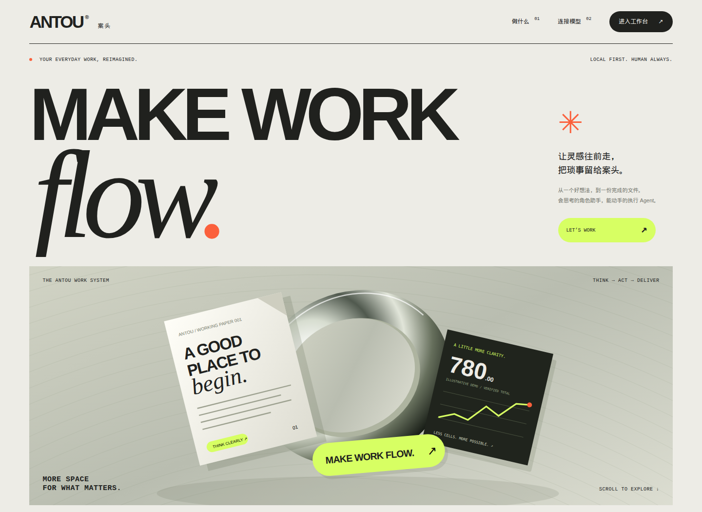
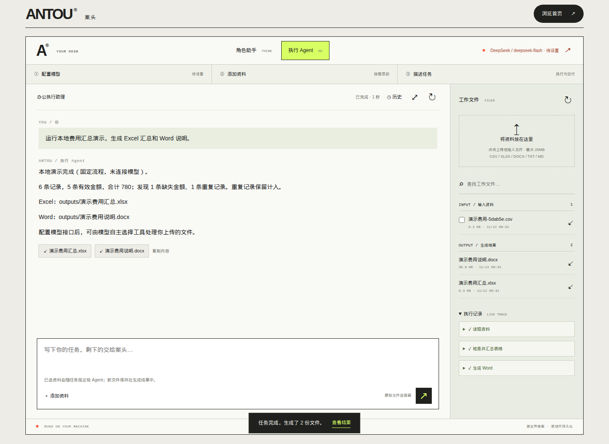
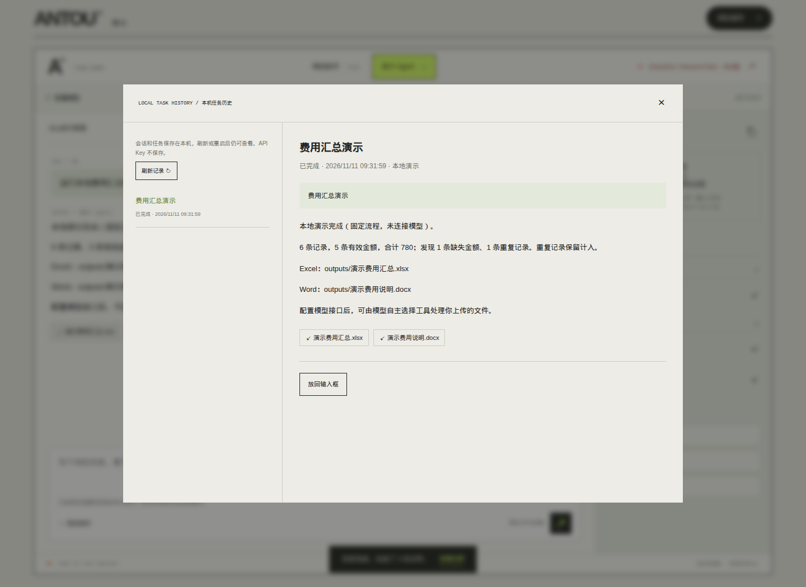

# ANTOU 案头

[](https://github.com/jjh-python667/antou-office-agent/actions/workflows/tests.yml)

案头是一个在你自己电脑上运行的办公助手。本机 Python 进程提供页面，并按你填写的地址调用 Chat Completions 接口。角色助手用来讨论和写作；执行 Agent 可以连续调用文件工具，读取资料并生成 Excel 与 Word。服务只监听 `127.0.0.1`。仓库里没有公网后端，单元测试也不会请求收费模型。

ANTOU is a local office assistant. A Python process on your machine serves the page and calls a Chat Completions endpoint you configure. Role mode is for discussion and writing. Agent mode can call file tools, read the files you select, and write Excel and Word. The server binds to `127.0.0.1` only. This repository has no hosted backend, and the unit tests do not call a paid model.

[项目说明 / Project note](docs/PROJECT.md) · [v3.2 记录](CHANGES-v3.2.md) · [作者页面](https://jjh-python667.github.io/)

## 它做什么 / What it does

- **两种模式。** 角色助手保留当前会话，不提供文件工具。执行 Agent 把模型返回的工具调用交给 `office_tools`，再把真实结果交回模型。每次任务最多 10 轮，每轮最多 8 次工具调用。一次只跑一个任务。
- **五个工具：** `list_files`、`read_file`、`summarize_table`、`create_spreadsheet`、`write_document`。可读 txt、md、csv、xlsx、docx。上传单文件不超过 20MB。表格上限是 50000 行、200 列。
- **金额汇总在程序里用 `Decimal` 计算。** 重复行保留并计入，缺失或非数字金额不计入，缺少分组的有效金额进入空分组。超过 Excel 15 位有效数字的金额按文本保存。没有缓存值的公式标为「公式未计算」，不计入合计。生成的 xlsx 会重新打开核对行数；生成的 docx 会重新打开核对段落。Word 校验不包含页面排版。
- **七个 Chat Completions 预设：** DeepSeek、OpenAI、通义千问（百炼兼容地址）、Kimi、硅基流动、Ollama、自定义 Base URL。请求打到 `/chat/completions` 和 `/models`。DeepSeek 发送 `thinking.type`，通义千问发送顶层 `enable_thinking`，OpenAI 使用 `max_completion_tokens`，其余预设使用 `max_tokens`。思考开关只对 DeepSeek 和通义千问写入这些字段。
- **正文可以流式显示。** 页面默认打开流式；接口里省略 `stream` 时按非流式处理。若上游直接返回 JSON，而不是 SSE，服务会整段交给页面。`reasoning_content` 留在模型协议消息里，不作为正文发给页面。工具参数会先拼完整再执行。
- **上下文预算是保守估算。** 默认最大输出 6000、上下文 32000，可在设置里改。估算方法是 UTF-8 字节长度加上固定余量，并计入工具 schema。超预算时只删掉最早的完整用户轮次。当前这一轮本身放不下时，调用模型之前就报错。
- **成功的会话和任务写在本机 SQLite：** `workspace/.antou/state.sqlite3`。可以在「历史」里查看、下载成品、恢复成功会话，或把原任务放回输入框。API Key 和 `Authorization` 头不写入这个库。取消、失败和不完整的流不会记成成功会话。进程再次启动时，上次仍为 `running` 的任务会标成中断。
- **页面上的本地演示不调用模型。** `app.py` 里的 `demo()` 写入一份固定 CSV（6 行数据：一笔金额为空，一笔与前面重复），再调用读取、汇总和写 Word。完成提示里的合计是 780。
- **可以停止任务。** 停止、刷新或关掉页面后，不再开始下一步。已经发出的那一次模型请求仍可能被服务商计费。正在执行的单个工具会跑完，然后才停止后续步骤。

Two modes. Role chat keeps the current conversation and has no file tools. The agent hands model tool calls to `office_tools` and sends the real result back. A task allows at most 10 rounds and 8 tool calls per round. Only one task runs at a time.

Five tools: `list_files`, `read_file`, `summarize_table`, `create_spreadsheet`, `write_document`. They accept txt, md, csv, xlsx, and docx. One upload is at most 20MB. Tables stop at 50,000 rows and 200 columns.

Sums use `Decimal` in process. Duplicate rows are kept and counted. Missing or non-numeric amounts are left out. Valid amounts with a missing group land in an empty group. Amounts with more than 15 significant digits are stored as text. Formulas without a cached value are labeled and excluded. A new xlsx is reopened to check the row count. A new docx is reopened to check paragraphs. That check does not render a page in Word.

Seven Chat Completions presets: DeepSeek, OpenAI, Qwen (DashScope compatible-mode URL), Kimi, SiliconFlow, Ollama, and a custom base URL. Calls go to `/chat/completions` and `/models`. DeepSeek gets `thinking.type`, Qwen gets top-level `enable_thinking`, OpenAI uses `max_completion_tokens`, and the other presets use `max_tokens`. The thinking field is sent only for DeepSeek and Qwen.

Assistant text can stream. The page turns streaming on by default. Omitting `stream` on the HTTP API selects a single response. A JSON body, instead of server-sent events, is passed through as the whole reply. `reasoning_content` stays in the protocol message and is not shown as the answer. Tool arguments are assembled before a tool runs.

The context budget is a conservative estimate. Defaults are 6,000 output tokens and a 32,000 context window, both editable in settings. The estimate is UTF-8 byte length plus a fixed margin, including the tool schema. When the budget is exceeded, only the oldest complete user turn is dropped. If the current turn itself does not fit, the server reports an error before calling the model.

Successful sessions and tasks are stored in local SQLite at `workspace/.antou/state.sqlite3`. History can show a task, download its files, restore a successful session, or put the original text back in the composer. API keys and `Authorization` headers are not stored. Cancelled, failed, and incomplete streams are not saved as successful sessions. On the next process start, a task still marked `running` is marked interrupted.

The in-page demo does not call a model. `demo()` in `app.py` writes a fixed CSV (six data rows: one blank amount, one duplicate), then reads it, summarizes it, and writes a Word file. The completion message states a total of 780.

A running task can be stopped. After stop, refresh, or closing the page, no further step starts. The provider may still charge for the request already sent. The tool that is already running finishes, and later steps are skipped.

## 当前边界 / Present limits

这些是当前代码的边界，避免把预设地址理解成已经用真实账号联调过。

- 监听地址是 `127.0.0.1`。写接口还要校验 `Host`、`X-Office-Token` 和来源 `Origin`。`GET /download` 只检查 `Host`，并且只能下载工作目录 `inputs/` 与 `outputs/` 里的文件。
- 远程 Base URL 必须是 HTTPS。HTTP 只允许 `127.0.0.1`、`localhost` 和 `::1`。地址里不能带用户名、密码、查询参数或片段。发生重定向时不跟随，也不把密钥转到另一个主机；需要改成最终地址。
- 环境变量里的 Key 只发给该预设的官方协议、主机和端口。自定义接口不读取环境变量 Key。改过 Base URL 之后，要在页面里填写这个地址自己的 Key。
- 浏览器 `localStorage` 键 `antou.preferences.v3` 保存服务商、Base URL、模型名、思考开关、输出上限、上下文预算和是否流式。API Key、角色要求和对话正文不在里面。`sessionStorage` 键 `antou.opening.seen` 只记录开场动画是否播放过。
- 状态库不加密，也没有自动删除。成功会话里会有角色要求、任务正文、模型可见的消息和读取过的资料片段。分享或备份时要排除整个 `workspace/`。
- 工具集是上面那五个。代码路径里没有 PDF、OCR、邮件、定时任务、多用户登录，也没有任意命令或脚本执行。
- 单元测试使用本机假上游。仓库不能证明某个云端模型已经开通、支持工具调用，或和 Microsoft Excel / Word 的版式一致。
- token 数字是估算，不是该模型官方 tokenizer 的计数。

These are the limits of the code in this tree.

- The listen address is `127.0.0.1`. Write routes also check `Host`, `X-Office-Token`, and `Origin`. `GET /download` checks `Host` only, and it can only read files under the workspace `inputs/` and `outputs/` directories.
- A remote base URL has to be HTTPS. HTTP is limited to `127.0.0.1`, `localhost`, and `::1`. The URL cannot carry a username, password, query, or fragment. Redirects are not followed, and the key is not sent to another host.
- An environment-variable key is sent only to that preset's official scheme, host, and port. The custom preset does not read an environment key. After the base URL changes, type the key for that URL in the page.
- Browser `localStorage` key `antou.preferences.v3` stores the provider, base URL, model name, thinking flag, output limit, context budget, and streaming flag. It does not store the API key, role text, or conversation. `sessionStorage` key `antou.opening.seen` records whether the opening animation has played.
- The SQLite file is not encrypted and rows are not deleted automatically. A successful session stores the role text, the task, the model-visible messages, and excerpts that were read. Exclude the whole `workspace/` directory from backups and shares.
- The tool set is the five names above. This tree has no PDF, OCR, email, scheduler, multi-user login, or arbitrary command execution.
- The unit tests use a local fake upstream. They do not show that a cloud model is enabled, that it supports tools, or that a file matches Microsoft Excel or Word layout.
- Token figures are an estimate, not that model's tokenizer.

## 安装与运行 / Install and run

需要 Python 3.9 或更新版本。第三方依赖只有 `openpyxl` 和 `python-docx`（见 `requirements.txt`）。页面、GSAP 和样式都在仓库里，不需要前端构建，也不从 CDN 加载脚本。

Python 3.9 or newer. The Python dependencies are `openpyxl` and `python-docx`, listed in `requirements.txt`. The page, GSAP, and CSS ship in the repository. There is no frontend build and no script CDN.

Windows：在项目目录双击 `start.cmd`。脚本会在需要时创建 `.venv` 并安装依赖，然后运行 `app.py`。

macOS / Linux：

```sh
chmod +x start.sh   # once, if the executable bit is missing
./start.sh
```

Debian / Ubuntu 上创建 `.venv` 需要系统包 `python3-venv`。没有这个包时，用下面的手动步骤，直接用能安装依赖的 Python 运行 `python app.py`。

On Debian and Ubuntu, creating `.venv` needs the `python3-venv` package. Without it, use the manual steps below and a Python that can install the requirements.

`start.cmd` 和 `start.sh` 都会把额外参数传给 `app.py`。加上 `--no-browser` 时不自动打开浏览器。

手动启动：

```sh
python -m venv .venv
# Windows: .venv\Scripts\activate
# macOS/Linux: source .venv/bin/activate
python -m pip install -r requirements.txt
python app.py
```

默认端口是 `8765`。这个端口被占用、且没有设置 `OFFICE_PORT` 时，进程会改用系统分配的空闲端口，以终端里打印的地址为准。`OFFICE_PORT` 指定的端口打不开时，进程直接退出。工作目录默认是 `workspace/`，可以用 `OFFICE_WORKSPACE` 改到别的可写目录。

数据在 `inputs/` 和 `outputs/` 下，位于工作目录内部。关掉启动这个进程的终端，服务就停。

The default port is `8765`. If that port is busy and `OFFICE_PORT` is unset, the process asks the OS for a free port and prints the URL. If `OFFICE_PORT` is set and that port cannot be opened, the process exits. The default workspace is `workspace/`. `OFFICE_WORKSPACE` points it somewhere else writable. Inputs and outputs live inside that directory. Stopping the terminal stops the server.

### 模型预设 / Provider presets

环境变量里的 Key 只在 Base URL 仍是该行官方源站时使用。模型名可以用对应的 `*_MODEL` 环境变量预填；除 DeepSeek 的 `deepseek-flash` 外，预设默认模型名为空，需要在页面读取列表或手写。

An environment key is used only while the base URL is still that row's official origin. A `*_MODEL` variable can prefill the model name. Aside from DeepSeek's `deepseek-flash`, the preset default model is empty until you load the list or type one.

| 预设 | 默认 Base URL | Key 环境变量 | 模型名环境变量 |
| --- | --- | --- | --- |
| DeepSeek | `https://api.deepseek.com` | `DEEPSEEK_API_KEY` | `DEEPSEEK_MODEL` |
| OpenAI | `https://api.openai.com/v1` | `OPENAI_API_KEY` | `OPENAI_MODEL` |
| 通义千问 | `https://dashscope.aliyuncs.com/compatible-mode/v1` | `DASHSCOPE_API_KEY` | `QWEN_MODEL` |
| Kimi | `https://api.moonshot.cn/v1` | `MOONSHOT_API_KEY` | `KIMI_MODEL` |
| 硅基流动 | `https://api.siliconflow.cn/v1` | `SILICONFLOW_API_KEY` | `SILICONFLOW_MODEL` |
| Ollama | `http://127.0.0.1:11434/v1` | `OLLAMA_API_KEY`（可空） | `OLLAMA_MODEL` |
| 自定义 | 由页面填写 | 只使用页面里填写的 Key | `CUSTOM_MODEL` |

Ollama 需要你自己安装、启动，并拉取模型。自定义接口要兼容 Chat Completions。「读取列表」和「测试对话连接」都会访问你填写的地址；测试对话可能产生费用。列表能连通，不表示每个模型都支持工具调用。

Ollama has to be installed, running, and holding a model you choose. A custom endpoint needs to speak Chat Completions. "Load models" and "Test chat" both contact the URL you entered. A chat test can spend credit. A model list does not mean every id supports tools.

接口说明（预设作者采用的公开文档，不是本仓库的测试报告）：

- DeepSeek: <https://api-docs.deepseek.com/guides/tool_calls/>
- OpenAI: <https://developers.openai.com/api/reference/chat-completions/overview>
- 百炼: <https://help.aliyun.com/en/model-studio/base-url>
- Kimi: <https://platform.kimi.com/docs/api/chat>
- 硅基流动: <https://api-docs.siliconflow.cn/docs/userguide/quickstart>
- Ollama: <https://docs.ollama.com/api/openai-compatibility>

### 页面操作 / Using the page

- 开场动画约 4.3 秒，可点「跳过」或按 Esc。同一标签页里用 `sessionStorage` 记住已播放，右上角可以重播。系统开启「减少动态效果」时，开场和滚动位移动效关闭。GSAP 加载失败时，开场层会去掉，办公功能仍由 `ui.js` 运行。
- 专注模式在工作台右上角，快捷键是 Ctrl/Cmd + K。Esc 在设置窗关闭时退出专注模式；若手机文件面板开着，Esc 先关面板。
- 设置要点「应用设置」才生效。关掉设置窗会丢掉这次没应用的修改。Ctrl/Cmd + 逗号打开设置。
- 上传后的文件会自动选入本次任务，最多 10 份。文件列表按修改时间从新到旧排列，可以按名称搜索。角色助手收到附件时，页面会改去执行 Agent，不自动发出请求。
- 新建会话可以在开始编辑或发出新任务前撤销。未发送的草稿只留在当前页面。

The opening animation runs about 4.3 seconds. Skip it with the button or Esc. `sessionStorage` remembers it for the tab, and the corner button can replay it. `prefers-reduced-motion` disables the opening and scroll motion. If GSAP fails to load, the opening layer is removed and `ui.js` still runs the office UI.

Focus mode is the control at the top right of the workbench, or Ctrl/Cmd + K. Esc leaves focus mode while the settings dialog is closed. If the narrow-screen file panel is open, Esc closes that panel first.

Settings apply only from "应用设置". Closing the dialog drops unapplied edits. Ctrl/Cmd + comma opens settings.

Uploads are selected for the current task, up to 10 files. The file list is newest first and can be filtered by name. Choosing attachments in role mode switches the page to the agent and does not send the request by itself.

A new chat can be undone until you edit or start another task. An unsent draft stays in the current page only.

## 测试 / Tests

```sh
python -m pip install -r requirements.txt
python -m unittest -v
```

当前树里有 47 个 `test_*` 方法：`test_app.py`、`test_providers.py`、`test_ux.py`、`test_v31.py` 共 30 个，`test_v32.py` 17 个。它们覆盖本地文件工具、本机假上游上的对话与工具协议、会话和 Key 范围、Excel 数值与公式标记、流式输出、上下文预算、任务历史，以及一次真正重启 `app.py` 进程后的会话恢复。

GitHub Actions 工作流 `.github/workflows/tests.yml` 在 `ubuntu-latest` 和 `windows-latest` 上使用 Python 3.11 运行同一条 `python -m unittest -v`。上面的徽章指向这个工作流。

This tree contains 47 `test_*` methods: 30 across `test_app.py`, `test_providers.py`, `test_ux.py`, and `test_v31.py`, plus 17 in `test_v32.py`. They cover the local file tools, chat and tool protocol against a local fake upstream, sessions and key scope, Excel numbers and formula labels, streaming, the context budget, task history, and session restore after a real `app.py` process restart.

The workflow `.github/workflows/tests.yml` runs that same command on Python 3.11 for `ubuntu-latest` and `windows-latest`. The badge points at that workflow.

## 项目结构 / Layout

```
app.py                 本机 HTTP 服务、会话和 Agent 循环
providers.py           七个预设、请求、流式解析、错误文本
office_tools.py        路径限制、统计、Excel / Word
context_budget.py      上下文估算和按整轮删减
local_state.py         SQLite 会话与任务历史
index.html             页面
assets/ui.js           设置、上传、对话、历史
assets/motion.js       开场和滚动动效
assets/styles.css      主视觉
assets/ux.css          专注模式和交互状态
assets/p1.css          历史和高级设置
assets/gsap.min.js     GSAP 3.15.1（第三方）
assets/ScrollTrigger.min.js
assets/*.svg           本项目插画
test_*.py              标准库 unittest
requirements.txt
start.cmd / start.sh
docs/PROJECT.md
docs/screenshots/      从本机页面截取的界面
CHANGES-v3.1.md        v3.1 当时的修改记录
CHANGES-v3.2.md        v3.2 当时的修改记录
BASELINE-v3.1.json     记录中的 v3.1 源码包 SHA-256 与文件哈希
CHANGELOG.md           本仓库此后的变更
LICENSE                项目代码的 MIT 许可
.github/workflows/tests.yml
```

`BASELINE-v3.1.json` 记录的压缩包不在本仓库里，这里没有重新计算那个包的哈希。v3.1 / v3.2 的过程说明以那两份 CHANGES 文件为准。

The zip named in `BASELINE-v3.1.json` is not in this repository, so this tree does not recompute that archive hash. The v3.1 and v3.2 notes live in the two CHANGES files.

运行产生的 `workspace/`、`.venv/`、`__pycache__/`、日志、SQLite 和 `.env` 已写在 `.gitignore` 里。

Generated `workspace/`, `.venv/`, `__pycache__/`, logs, SQLite files, and `.env` are listed in `.gitignore`.

## 界面 / Interface

下面三张图是 2026-11-11 在本仓库启动的页面上截的：桌面宽度、系统「减少动态效果」打开、先跑内置演示，再打开本机历史。图中的 780 来自 `demo()` 那份固定 CSV，不是云端模型的输出。

These three images were captured on 2026-11-11 from the page served by this repository: desktop width, reduced motion, after the built-in demo, then the local history dialog. The 780 in the picture is the fixed CSV from `demo()`, not a cloud model.







## 本机 HTTP / Local HTTP

写请求是 JSON，并带 `X-Office-Token`（页面源码里的 `__TOKEN__` 会在响应时换成进程启动时生成的令牌）。不要把 Key 放进 URL。

- `GET /api/health`：`status`、`version`（当前为 `3.2`）、`baseline`、预设数量和工具数量。
- `GET /api/providers`：公开预设。只有是否存在环境变量 Key 的布尔值，没有密钥本身。
- `GET /api/config`：兼容早期调用的 DeepSeek 默认模型和同一份公开预设。
- `GET /api/files`：工作文件，最多 300 个，按修改时间从新到旧。
- `GET /api/history?limit=50&offset=0`：任务列表。`limit` 会收进 1–100。
- `GET /api/history/{task_id}`、`GET /api/sessions/{session_id}`：任务详情，或成功会话的正文和不含密钥的连接设置。
- `POST /api/models`、`POST /api/test`：读取模型列表，或发一条只要求回复 OK 的对话。
- `POST /api/chat`：NDJSON。常见事件有 `task`、`session`、`session_expired`、`context_budget`、`answer_delta`、`reply_end`、`answer`、`tool_start`、`tool_end`、`cancelled`、`error`、`done`。页面只在 `done` 之后采用新的 `session_id`。
- `POST /api/cancel`：`{"task_id": "..."}`。
- `POST /api/upload`：`{"name","data"}`，`data` 是文件的 base64。扩展名必须是 txt、md、csv、xlsx、docx。
- `POST /api/demo`：本地演示的 NDJSON。
- `GET /download?path=outputs/...`：下载工作文件。

聊天体里还有 `provider`、`base_url`、`api_key`、`model`，以及可选的 `thinking`、`max_output_tokens`（256–16000）、`context_window`（4096–1000000，并且要大于输出上限加 512）、`text`（最多 20000 字）、`mode`（`role` 或 `agent`）、`session_id`、`stream`、`role_prompt`（最多取 6000 字）和 `attachments`（最多 10 个路径，仅 Agent）。POST 正文超过 29MB 会拒绝。

Write requests are JSON and include `X-Office-Token`. The page template's `__TOKEN__` is replaced with a token created when the process starts. Keep keys out of URLs.

`max_output_tokens` is an integer from 256 to 16000. `context_window` is an integer from 4096 to 1000000 and must exceed the output limit by more than 512. `text` is at most 20,000 characters. `role_prompt` is stored up to 6,000 characters. `attachments` allows at most 10 paths, and only in agent mode. A POST body above 29MB is rejected.

## 许可 / License

本仓库的项目代码采用 [MIT License](LICENSE)，版权人为 工匠（jjh-python667），2026。

Project code in this repository is under the [MIT License](LICENSE), copyright 工匠 (jjh-python667), 2026.

## 第三方文件 / Third-party files

`assets/gsap.min.js` 与 `assets/ScrollTrigger.min.js` 是 GSAP 3.15.1，随这个仓库附带，适用 GreenSock Standard License。版权声明保留在文件头，说明见 [assets/THIRD-PARTY.txt](assets/THIRD-PARTY.txt)。SVG 插画是本项目的文件。

`assets/gsap.min.js` and `assets/ScrollTrigger.min.js` are GSAP 3.15.1 and ship with this repository under GreenSock's Standard License. The file headers keep the upstream notice. See [assets/THIRD-PARTY.txt](assets/THIRD-PARTY.txt). The SVG illustrations are files from this project.
